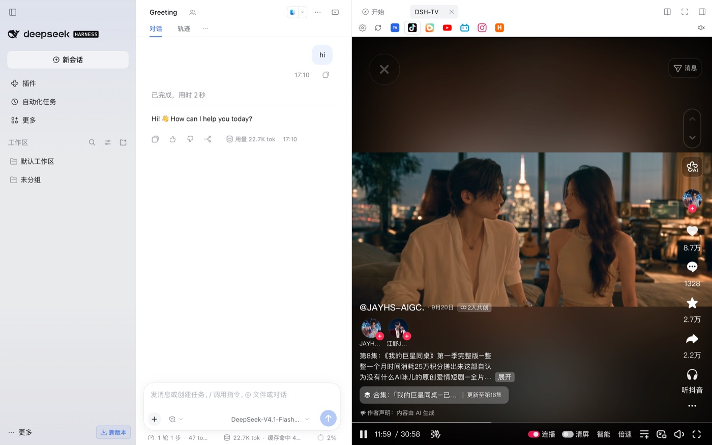
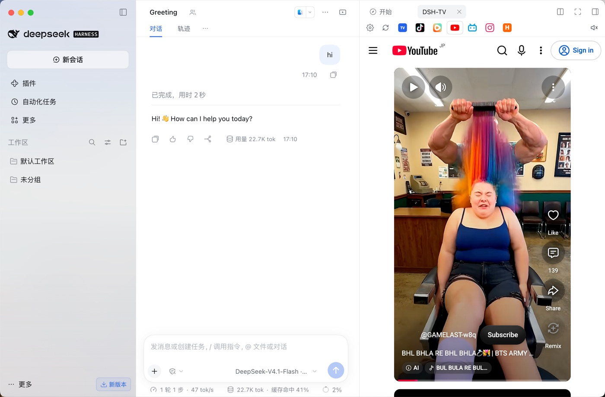
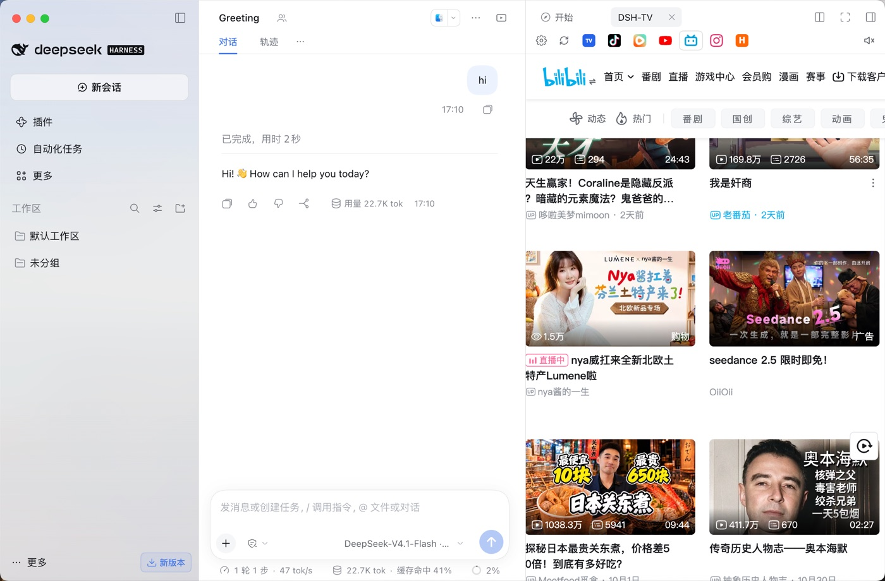
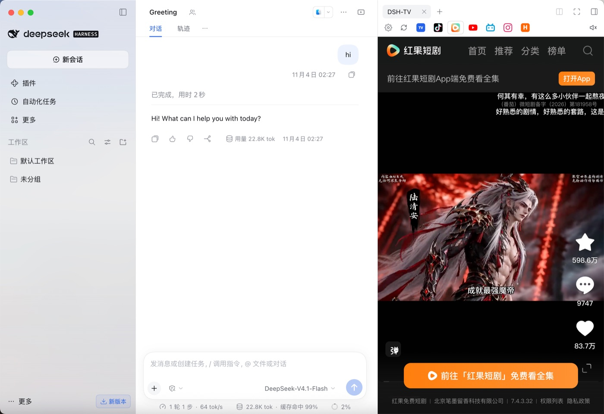
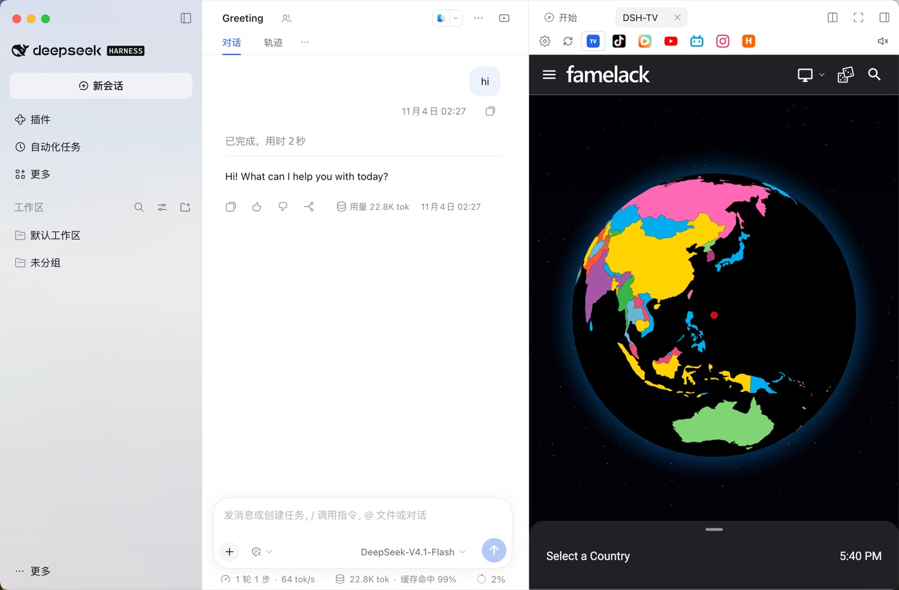
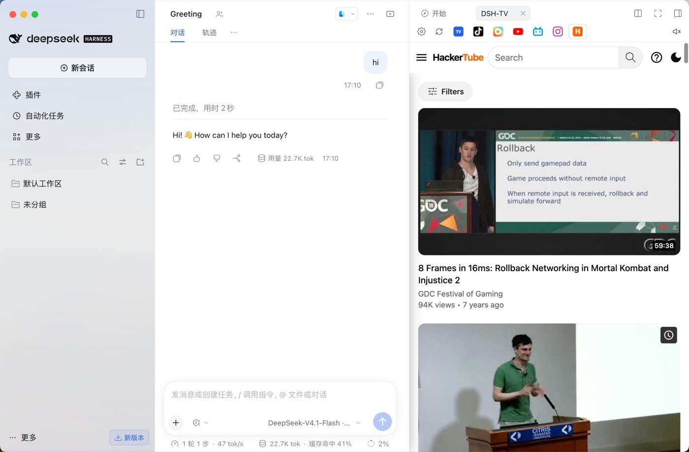
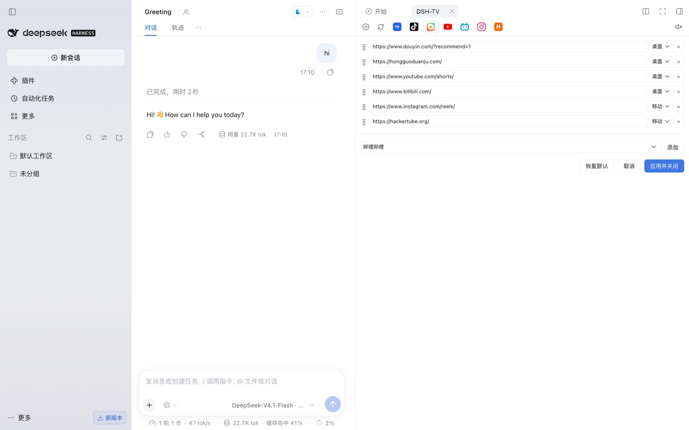

# dsh-tv

**English** | [中文](README.zh.md)

> **Mirror:** if `github.com` web pages are slow or blocked (504) in your network, read this README via jsDelivr: <https://cdn.jsdelivr.net/gh/MathewWuZJ/dsh-tv@main/README.md>. Git-based installs are unaffected.

A [DeepSeek Harness](https://github.com/deepseek-ai/deepseek-harness) (DSH) plugin that opens a **short-video / TV panel in the right sidebar**, so you can watch something while an agent works. On Desktop it embeds a real Electron `<webview>` (real browser engine), not an iframe.

> Not affiliated with DeepSeek, Douyin, YouTube, Bilibili, Instagram or any listed site. Site names and icons belong to their owners.

## Features

- **One entry, top-right**: a `DSH-TV` icon button in the conversation header opens / collapses the panel.
- **Tab bar with real favicons** (no text labels): Douyin, Short-drama, YouTube, Bilibili, Instagram, HackerTube, plus **Global TV** pinned first.
- **Global TV (random)**: a self-hosted player picks a random public IPTV channel from public playlists (iptv-org / community lists), validates the stream (HLS + first segment fetch, prefers H.264, skips DRM/HEVC-only) before playing, with a "换台 / next" button and a channel picker (countries + search).
- **Settings panel** (gear): edit each site's URL, choose mobile/desktop UA, drag to reorder, delete, and add from a built-in catalog of mainstream video sites. Saved to `localStorage`.
- **Per-tab keep-alive**: switching tabs does not reload the page; last URL / scroll / playback position is remembered.
- **Global volume + mute memory**: one slider/mute for all tabs; starts **muted at 1/3 volume**; your changes are remembered.
- **Purposely no cookies from Chrome**: each site runs in an isolated session; log in once inside the panel.

## Screenshots

| Douyin | YouTube |
|---|---|
|  |  |
| **Bilibili** | **Short-drama** |
|  |  |
| **Global TV** | **HackerTube** |
|  |  |

**Settings panel**



## Install

### 1) From GitHub (recommended)

```sh
dsh plugin --profile desktop add github:MathewWuZJ/dsh-tv
```

Then add `dsh-tv` to your profile's `dsh.profile.bundles` (the plugin manager's "Enable"/toggle usually does this), and restart DSH.

### 2) From a local directory

```sh
cd dsh-tv
./install.sh                 # installs into the active desktop profile
```

### 3) As a plugin-market index entry

DSH has no central third-party marketplace; third parties publish packages and **custom plugin indexes**. This repo ships `market-index.json` (format 1). In DSH enable **Plugins → Discover → Custom plugin indexes**, add:

```
https://cdn.jsdelivr.net/gh/MathewWuZJ/dsh-tv@main/market-index.json
```

then install from the Discover tab.

## Compatibility & avoiding "plugin disappeared after DSH upgrade"

DSH enforces each plugin's `engines.dsh` range; a bundle that does not match is **silently skipped** (no entry, cannot open). This package declares:

```json
"engines": { "dsh": ">=0.2.0 <0.3.0" }
```

- The range intentionally allows every `0.2.x`. If DSH later moves to `0.3.x` (or a new major), a new release of this plugin must widen the range.
- When a version is skipped you can temporarily allow it per-version: `dsh plugin allow-version` (plugin manager) — exact-version exemption only.
- Best practice for authors: keep `engines.dsh` a **range** (not an exact prerelease), test against the newest DSH, and publish updated releases on major bumps.

## Usage

- Open the panel from the `DSH-TV` button in the chat header (top-right).
- Switch sites via favicon tabs. The first visit shows a spinner; the page is revealed only after it loads.
- Global TV: opens a random validated channel; **地图** opens the map/channel picker, **换台** picks another.
- Gear: edit sites; **地图** (player) can fall back to the built-in picker when the external map is unreachable.
- Volume: click the speaker to mute; hover/click to adjust; settings persist.

## FAQ / Q&A

**Q: After upgrading DSH, the DSH-TV entry disappeared and I can't open it.**
A: DSH skipped the bundle because its `engines.dsh` is incompatible with the new runtime. Update to a plugin release that matches, or grant an exact-version exemption with `dsh plugin allow-version`. See "Compatibility" above.

**Q: A site shows a blank page or stays on the spinner.**
A: Many sites refuse to be embedded or are region/network restricted. The panel reports a load failure instead of hiding it; try the site's desktop/mobile mode in Settings, or open it in your system browser.

**Q: Can it use my Chrome cookies / logins?**
A: No. The embedded browser is an isolated session and is not allowed to read Chrome's cookie store. Log in once inside the panel; some login state can be remembered locally on a best-effort basis (non-HttpOnly cookies + localStorage).

**Q: Where does Global TV come from?**
A: Public IPTV playlists (mostly iptv-org and community lists). Streams are community-maintained; some are offline or geo-blocked. The player validates a channel before returning it and auto-switches on failure. No streams are hosted by this project.

**Q: Is there an official plugin marketplace?**
A: Not for third-party plugins. Distribution is: npm package (`dsh plugin add <pkg>`), GitHub install (`github:owner/repo`), or a custom market index JSON added in Discover. Official bundles are shipped by DSH itself.

**Q: Is my data sent anywhere?**
A: The plugin only loads the sites you open and the global TV playlists. Session snapshots (for best-effort login resume) are written under `~/.dsh/social-session/`; the TV playlist is cached there too. Nothing is sent to the author.

## Disclaimer

- This is a personal, non-official plugin. It does not host or re-distribute video content; it loads public websites and public IPTV playlists in a browser view.
- Respect each site's terms of service and local laws. Content copyright belongs to the respective rights holders.
- Use at your own risk.

## Development

```
dsh-tv/
├── package.json        # DSH manifest: dsh.bundle.patch + dsh.client(platform=web)
├── cordis.patch.yml    # bundle patch: insert the loader entry
├── lib/index.js        # host half: session snapshot routes, global-TV player server (/player,/map,/random,/m3u8,/seg)
├── lib/client.js      # client half: right-sidebar tab type, UI, settings, per-site webviews
├── assets/icons/       # bundled real site favicons
├── assets/hls.min.js   # bundled HLS player for Global TV
└── install.sh          # local install helper
```

- Host runs in the DSH Host process; the Global TV player listens on its own loopback port so the guest webview may load it.
- Client bundle is plain `window.__ModuleLoader__.load({...})` and only requires baseline modules (`react`).

## License

[MIT](LICENSE)
