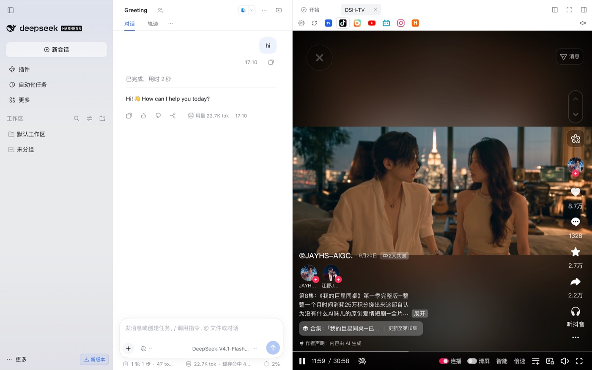
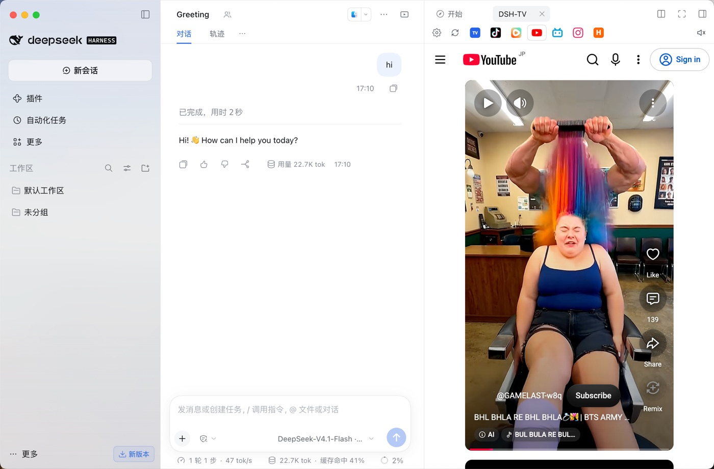
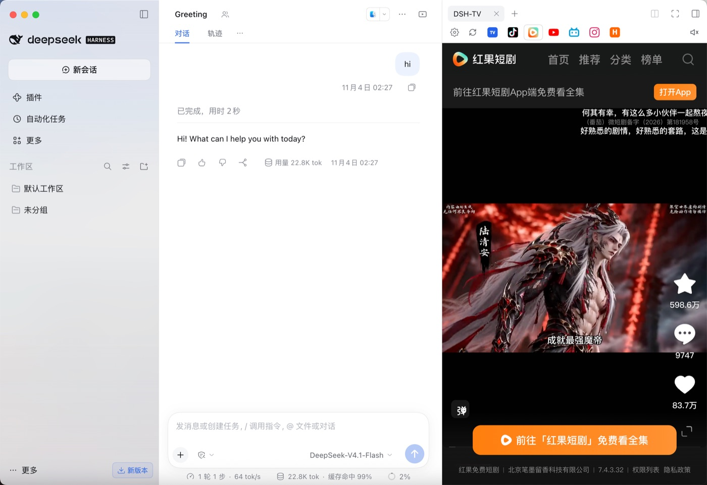
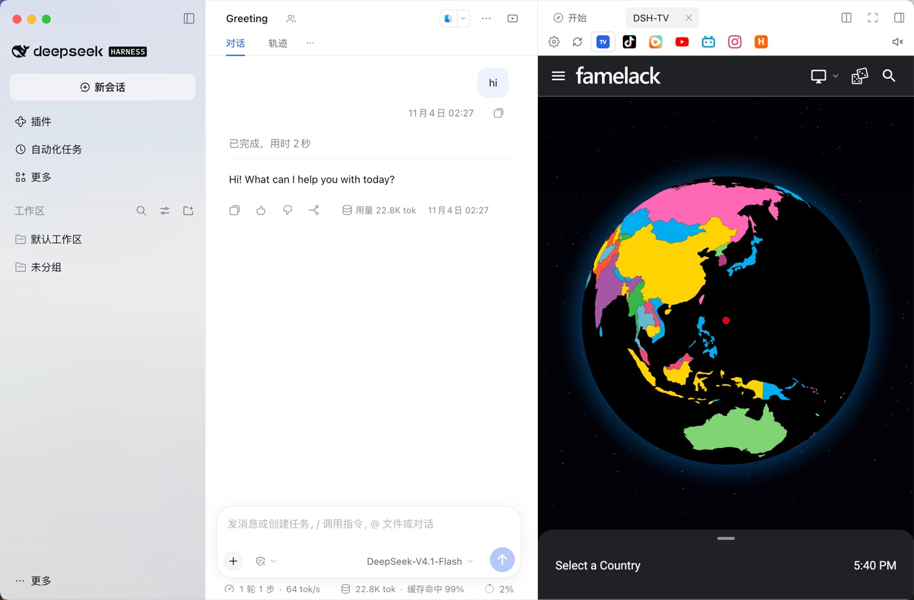
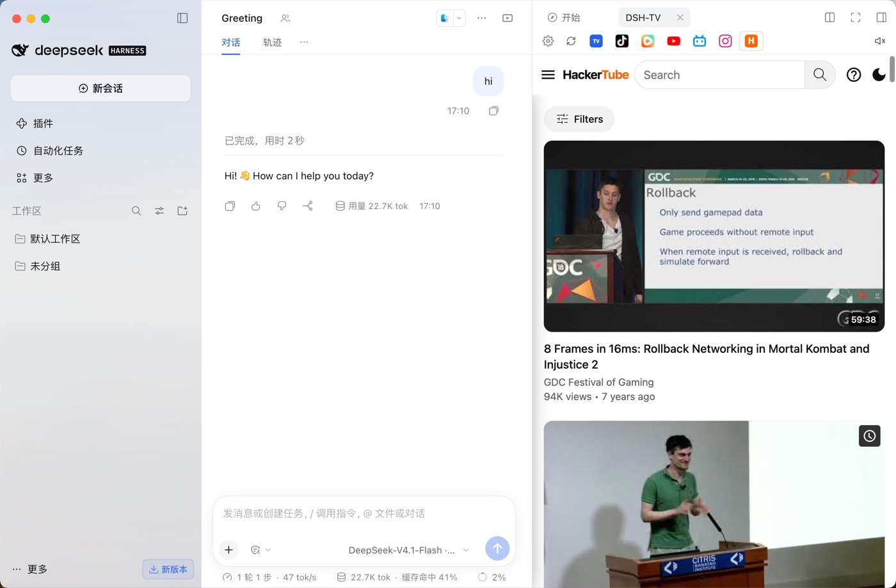
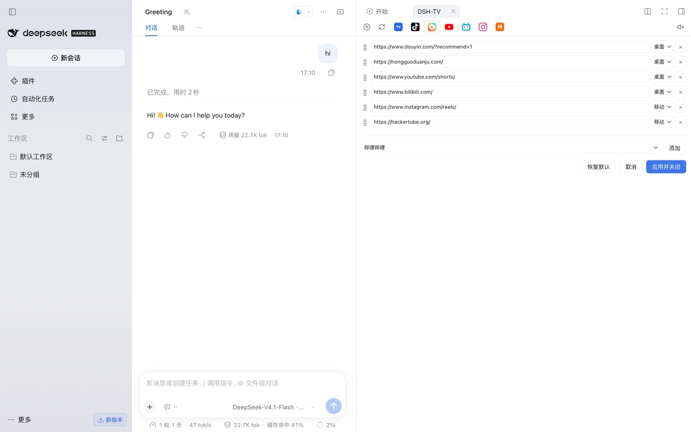

# dsh-tv

[English](README.md) | **中文**

> **镜像：** 如果你的网络访问 `github.com` 网页很慢或报 504，可用 jsDelivr 在线阅读：<https://cdn.jsdelivr.net/gh/MathewWuZJ/dsh-tv@main/README.zh.md>。用 `git` 安装不受影响。

一个 [DeepSeek Harness](https://github.com/deepseek-ai/deepseek-harness)（DSH）插件：在**右侧边栏**打开一个**短视频 / 电视面板**，让 Agent 干活时你可以在旁边刷视频。桌面版用真正的 Electron `<webview>`（真实浏览器内核）加载，不是 iframe。

> 与 DeepSeek、抖音、YouTube、Bilibili、Instagram 等无隶属关系；站点名称与图标归各自权利人所有。

## 功能

- **一个右上角入口**：对话头部右上角的 `DSH-TV` 图标按钮，点开/收起面板。
- **图标式 tab 栏**（不显示名称，用各站真实 favicon）：抖音、短剧、YouTube、Bilibili、Instagram、HackerTube，另外**全球频道**固定在最前。
- **全球频道（随机）**：内置自托管播放页，从公开 IPTV 播放列表（iptv-org / 社区列表）里随机选台，播放前会校验（HLS + 首个分片、优先 H.264、跳过 DRM/纯 HEVC），带「换台」和「地图（选台/按国家+搜索）」。
- **设置面板**（齿轮）：改每个站点网址、选移动/桌面 UA、拖动排序、删除，并能从内置主流网站目录一键添加；配置存 `localStorage`。
- **切 tab 不重载**：保留页面、滚动位置与播放进度。
- **全局音量/静音记忆**：一个音量/静音作用于所有 tab；**默认启动静音、音量 1/3**；你改过后会记住。
- **不读取 Chrome Cookie**：每个站点是隔离会话；需要登录就在面板内登录一次。

## 截图

| 抖音 | YouTube |
|---|---|
|  |  |
| **Bilibili** | **短剧** |
|  |  |
| **全球频道** | **HackerTube** |
|  |  |

**设置面板**



## 安装

### 1）从 GitHub 安装（推荐）

```sh
dsh plugin --profile desktop add github:MathewWuZJ/dsh-tv
```

然后把 `dsh-tv` 加进 profile 的 `dsh.profile.bundles`（插件管理器的“启用”开关通常会做），重启 DSH。

### 2）从本地目录安装

```sh
cd dsh-tv
./install.sh                 # 安装到当前 desktop profile
```

### 3）作为插件市场索引安装

DSH 没有官方第三方市场，第三方通过**自定义插件索引**分发。本仓库内置 `market-index.json`（format 1）。在 DSH 里启用 **Plugins → Discover → Custom plugin indexes**，添加：

```
https://cdn.jsdelivr.net/gh/MathewWuZJ/dsh-tv@main/market-index.json
```

然后在 Discover 里安装。

## 兼容性与“升级后插件消失”的规避

DSH 会校验插件的 `engines.dsh` 范围；不匹配的 bundle 会被**静默跳过**（没有入口、打不开）。本包声明：

```json
"engines": { "dsh": ">=0.2.0 <0.3.0" }
```

- 该范围故意覆盖整个 `0.2.x`。当 DSH 升级到 `0.3.x`（或新大版本）时，需要发布新版本放宽范围。
- 被跳过时可临时用 `dsh plugin allow-version` 做**精确版本豁免**。
- 作者最佳实践：`engines.dsh` 用**范围**（不要写死精确预发布版本），面向最新 DSH 测试，并在大版本升级时发新版。

## 使用

- 从对话头部右上角 `DSH-TV` 按钮打开。
- 点 favicon tab 切换站点；首次进入显示转圈，加载完成才显示页面。
- 全球频道：打开即随机一个已校验频道；**换台**再随机，**地图**打开选台页。
- 齿轮：编辑站点；播放页的**地图**在外部地图不可达时会回落到内置选台。
- 音量：点喇叭静音；悬停/点击调音量；设置会记住。

## 常见问题（Q&A）

**Q：DSH 升级后 DSH-TV 入口没了、进不去？**
A：因为 `engines.dsh` 与新运行时判定不兼容，bundle 被跳过。更新到匹配的新版插件，或用 `dsh plugin allow-version` 做精确版本豁免。见上文“兼容性”。

**Q：某个站点白屏/一直转圈？**
A：很多站点拒绝被内嵌，或受地区/网络限制。面板会显示加载失败而不是假装正常；可在设置里切换该站点的“移动/桌面”，或用系统浏览器打开。

**Q：能用我 Chrome 里的 Cookie / 登录吗？**
A：不能。内嵌浏览器是隔离会话，读不到 Chrome 的 Cookie。请在面板内单独登录一次；部分登录态可尽力本地记住（非 HttpOnly Cookie + localStorage）。

**Q：全球频道的源从哪来？**
A：公开 IPTV 播放列表（主要是 iptv-org 与社区列表）。频道由社区维护，部分会失效或被地区限制；播放器会先校验再返回，失败自动换台。本项目不托管任何流。

**Q：有没有官方插件市场？**
A：第三方插件没有官方市场。分发方式为：npm 包（`dsh plugin add <包名>`）、GitHub 安装（`github:owner/repo`）、或 Discover 里添加**自定义索引 JSON**。官方 bundle 由 DSH 自身随版本提供。

**Q：会上传我的数据吗？**
A：不会。插件只加载你打开的站点和全球频道播放列表；会话快照（用于尽力恢复登录）写到 `~/.dsh/social-session/`，播放列表也缓存在此。不会上传给作者。

## 免责声明

- 个人非官方插件，不托管、不再分发任何视频内容；只在浏览器视图里打开公开网站与公开 IPTV 播放列表。
- 请遵守各站点服务条款与当地法律；内容版权归权利人所有。
- 使用风险自负。

## 开发结构

```
dsh-tv/
├── package.json        # DSH 清单：dsh.bundle.patch + dsh.client(platform=web)
├── cordis.patch.yml    # bundle 补丁：插入 loader 条目
├── lib/index.js        # host 半：登录快照路由、全球频道播放服务(/player,/map,/random,/m3u8,/seg)
├── lib/client.js       # client 半：右侧栏 tab 类型、UI、设置、各站 webview
├── assets/icons/       # 内置的真实站点图标
├── assets/hls.min.js   # 全球频道用的 HLS 播放库
├── assets/readme/      # 截图
└── install.sh          # 本地安装脚本
```

- Host 跑在 DSH Host 进程；全球频道播放器监听独立 loopback 端口，供 guest webview 加载。
- Client bundle 是纯 `window.__ModuleLoader__.load({...})`，只依赖基线模块（`react`）。

## 许可证

[MIT](LICENSE)
